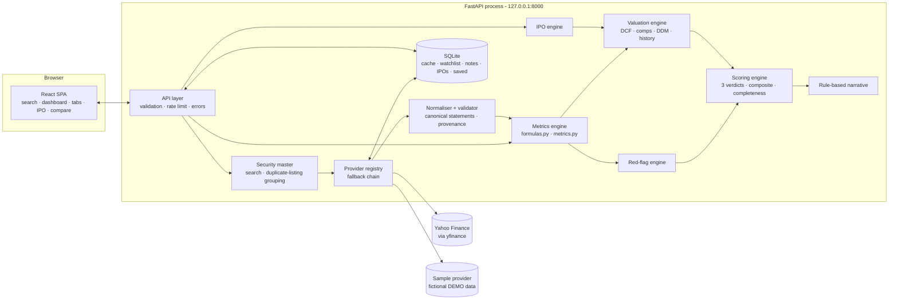
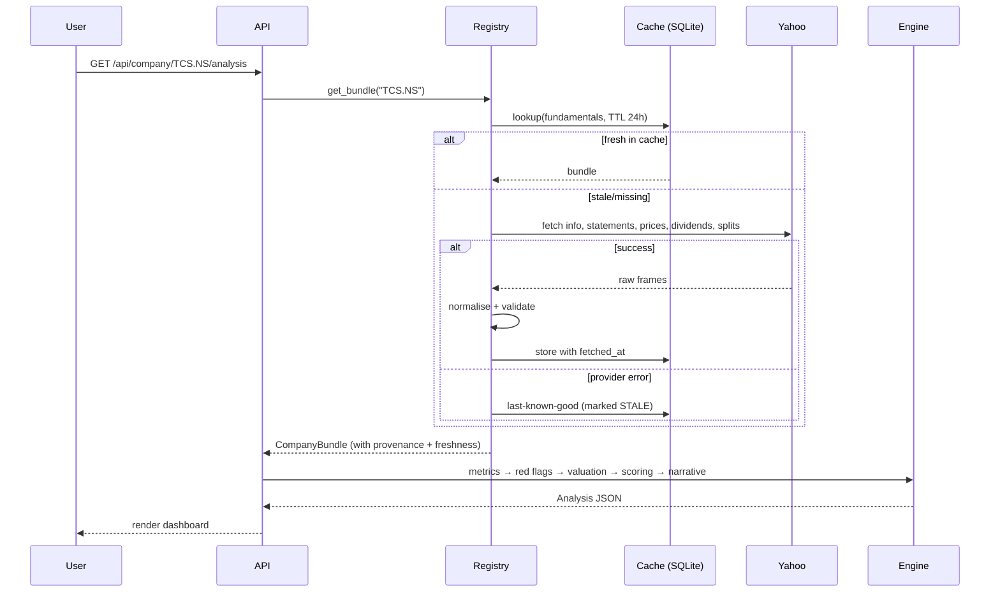
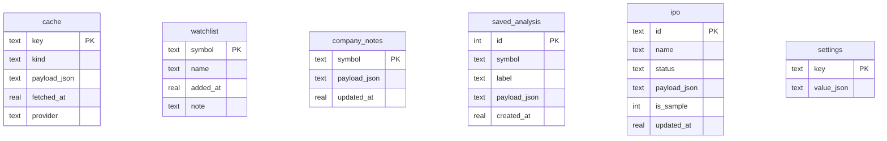

# Analytivest — System Architecture

Scope: a **single-user, locally-run** research tool for Indian equities (NSE/BSE) and IPOs, built so
that more markets and data providers can be added without touching the analytical core.
It uses **free data sources only** (see `DATA_SOURCES.md`).

## 1. Stack decision

| Layer | Choice | Why (vs. the suggested stack) |
|---|---|---|
| Frontend | **React 19 + TypeScript + Vite**, Tailwind CSS v4, Recharts, TanStack Query, React Router | Single-user local app → no SSR/SEO need, so Next.js adds weight without benefit. Vite gives fast builds; the built SPA is served by the backend so one command runs everything. |
| API | **Python FastAPI** | Same language as the numerical engine; typed request validation via Pydantic. |
| Calculations | Python + pandas/NumPy (ingestion), pure-Python formula functions (engine) | The formula layer is plain functions over floats so every rule is unit-testable and inspectable. |
| Database | **SQLite** (file `%LOCALAPPDATA%\Analytivest\stockiq.db`, outside synced folders) | One user, low write volume. PostgreSQL would need a server to install and run. The DB module is isolated so it can be swapped. |
| Cache | **SQLite cache table with TTLs** (no Redis) | Provider rate limits are the real constraint, not throughput. A persistent cache also serves as the "last known good" fallback. |
| Background jobs | **None scheduled; refresh-on-read with TTL + manual refresh** | A personal app does not need a task queue. Data is refreshed when you open a company and the cache is stale. |
| Auth | **None; server binds to 127.0.0.1 only** | Personal-use instruction. If the app is ever published, add auth (see §9). |
| Reports | CSV from the API; PDF via a print-optimised stylesheet (browser "Save as PDF") | Avoids heavy PDF dependencies; output is the same page the user sees. |

## 2. High-level architecture

## 3. Component boundaries (backend `app/`)

| Module | Responsibility | Depends on |
|---|---|---|
| `main.py` | HTTP routes, SPA hosting, error mapping, rate limiting | everything below |
| `markets.py` | Market registry (IN: NSE/BSE, US) — suffixes, currency, display units, statutory tax rate, default discount rate | – |
| `providers/base.py` | `Provider` protocol + `ProviderError`; canonical `CompanyBundle` | `models.py` |
| `providers/yahoo.py` | Yahoo adapter → canonical model (field mapping, NaN→missing, split detection) | yfinance |
| `providers/sample.py` | Fictional DEMO companies for offline use; always labelled `SAMPLE` | – |
| `providers/registry.py` | Chooses provider by symbol, cache-first reads, stale fallback on failure | db, providers |
| `engine/formulas.py` | Pure, guarded formulas (growth, CAGR, ratios) returning value **or** a reason it is not meaningful | – |
| `engine/metrics.py` | Builds metric time series + latest snapshot from statements, each with provenance | formulas |
| `engine/redflags.py` | Rule-based warnings with evidence, severity, period, implication | metrics |
| `engine/valuation.py` | Multiples, EV, historical ranges, DCF + sensitivity, comps, DDM, fair-value range | metrics |
| `engine/scoring.py` | Category scores, 3 verdicts, composite, completeness, confidence, labels — driven by `scoring_config.json` | metrics, valuation, redflags |
| `engine/ipo.py` | Issue structure, implied valuation, scenarios, IPO-specific risk assessment | formulas, valuation |
| `engine/narrative.py` | Deterministic plain-English write-up (no LLM, no paid API) | all engine outputs |
| `db.py` | SQLite schema + data access | – |

Adding a market = add an entry in `markets.py`; adding a provider = implement `Provider` and register it.
The engine never sees provider-specific field names.

## 4. Data flow — analysing a company

## 5. Database schema (SQLite)

`company_notes` holds **user-entered** governance facts (promoter pledge %, auditor qualifications, litigation,
etc.) that free sources do not provide. They are always labelled "User-entered" with the source the user typed.

## 6. API (all JSON, prefix `/api`)

| Method | Path | Purpose |
|---|---|---|
| GET | `/health` | Liveness + provider status |
| GET | `/search?q=` | Autocomplete; groups NSE/BSE listings of the same company |
| GET | `/company/{symbol}/analysis` | Full analysis (profile, quote, statements, metrics, red flags, valuation, scores, narrative, provenance) |
| POST | `/company/{symbol}/refresh` | Bypass cache |
| GET | `/company/{symbol}/prices?range=1y\|3y\|5y\|10y\|max` | Price series (+ adjusted close for TSR) |
| GET | `/company/{symbol}/peers` | Peer set via Yahoo screener (same industry, India) |
| POST | `/company/{symbol}/dcf` | Recompute DCF with user assumptions |
| GET/PUT | `/company/{symbol}/notes` | User-entered governance data |
| GET | `/company/{symbol}/export.csv` | Metrics + statements CSV |
| GET | `/compare?symbols=A,B,…` (≤5) | Side-by-side key metrics and verdicts |
| GET/POST/DELETE | `/watchlist[/{symbol}]` | Watchlist |
| GET/POST/DELETE | `/saved[/{id}]` | Saved analysis snapshots |
| GET/POST | `/ipos`, GET/PUT/DELETE `/ipos/{id}` | IPO records (user-entered from RHP, or sample) |
| GET | `/ipos/{id}/analysis` | IPO evaluation |
| GET | `/methodology` | Live scoring config + rule descriptions (inspectable) |
| GET | `/glossary` | Metric explanations |
| GET | `/ml/anomalies` | Scanned universe ranked by the earnings-quality anomaly model, with reasons and rule flags |
| GET | `/company/{symbol}/anomaly` | One company scored against the scanned universe |
| GET | `/session` | Per-start session token (the only endpoint that does not need it) |
| GET | `/backup` | Download a JSON backup of all user data |
| POST | `/backup/encrypted` | Download it password-encrypted (body `password`, or the saved one) for manual upload |
| GET | `/backup/status` | Data location, table counts, backup files, security status |
| POST | `/backup/run`, `/backup/restore` (upload), `/backup/restore-file` | Save to the backup folder; restore |
| PUT | `/backup/settings` | Weekly auto-backup, local folder, how many to keep, local-only or + Google Drive, encryption password |
| POST | `/backup/purge-plain-cloud` | Delete unencrypted copies from the Google Drive folder |

## 7. Caching & update strategy

| Data | TTL | Notes |
|---|---|---|
| Quote / profile | 15 min | Yahoo NSE/BSE quotes are **delayed**; UI never labels them real-time |
| Statements, dividends, splits | 24 h | Annual data changes quarterly at most |
| Price history | 12 h | |
| Peers (screener) | 24 h | |
| Search | 24 h | |

On provider failure the registry returns the last cached payload flagged `stale=true` with its timestamp; with no
cache it returns a typed error that the UI shows with a Retry button. Calls to Yahoo are serialised with a small
minimum interval to stay polite.

## 8. Failure modes & fallbacks

| Failure | Behaviour |
|---|---|
| Yahoo 429 / network down | Serve stale cache with banner; else error + retry |
| Symbol not found / delisted | 404 with suggestions from search |
| Missing statement fields | Metric shows "Not available" with reason; excluded from scoring (never zero) |
| Negative / zero denominators | Ratio marked "Not meaningful" with reason |
| Missing quarters | TTM not computed from quarters; falls back to provider TTM, labelled |
| Split/bonus between periods | EPS & share counts adjusted when the period is detected as unadjusted |
| Bank / NBFC / insurer | Switches to financial-sector scoring model; industrial ratios hidden with explanation |
| Conflicting values (computed vs provider) | Reconciliation table flags >10% differences |

## 9. Security & privacy

- Server binds to `127.0.0.1`; CORS restricted to the local dev origin.
- **Request guard** (`main.guard`), because web pages open in the browser can still send requests to localhost:
  - the `Host` header must be `127.0.0.1`, `localhost` or `::1` (blocks DNS rebinding; extra names via
    `STOCKIQ_ALLOWED_HOSTS`);
  - requests with a foreign `Origin` or `Sec-Fetch-Site: cross-site` are refused (blocks CSRF, including
    "simple" form posts that CORS does not stop);
  - every `/api` call except `/api/session` must send `X-Analytivest-Token`, a random value generated at each
    start. Only same-origin pages can read `/api/session`; the frontend fetches it once and refreshes it after a
    401 (server restart).
- Response headers: strict Content-Security-Policy (no inline scripts; the theme bootstrap lives in
  `theme-init.js`), `X-Frame-Options: DENY`, `Cross-Origin-Resource-Policy: same-origin`, `no-store` on API responses.
- Uploads: 120 MB cap; ZIP containers (DOCX/XLSX/EPUB/ZIP) are checked before unpacking (total size, member count,
  compression ratio) and nesting is limited; `defusedxml` hardens openpyxl's XML parsing.
- Data lives in `%LOCALAPPDATA%\Analytivest`, not in the project folder: a OneDrive-synced live SQLite file is
  uploaded to the cloud and can be corrupted by sync. A database found at the old `backend/data` location is
  moved on first start (SQLite backup API, integrity and row-count checks, then the old files are deleted).
- Backups (`app/backup.py`) contain user tables only (no provider cache), are validated table by table and
  column by column against the live schema before a restore, and a safety backup is written before every restore.
  Optional off-site copies go to Google Drive through the "My Drive" folder of Google Drive for desktop (detected
  on drive letters D–Z and under the user profile); the app stores no Google credentials, and a missing Drive
  only marks the copy as failed while the local backup still succeeds.
- Google Drive copies can be encrypted (`app/backup_crypto.py`): AES-256-GCM, key from scrypt (N=2^17, r=8, p=1;
  parameters stored per file, capped on read), fixed associated data. The password is stored sealed with Windows
  DPAPI under the key `backup_secret`, which is excluded from exports and never returned by the API. Without a
  usable password no Drive copy is written (never a silent unencrypted fallback). Restores detect encrypted files
  and return `password_required` / `wrong_password` so the UI can ask for the password.
- No secrets required (no paid APIs). `.env.example` documents optional settings only.
- Input validation: symbols matched against `^[A-Za-z0-9.^&\-]{1,20}$`; Pydantic models for all bodies; numeric bounds on DCF/IPO inputs.
- In-memory rate limiting per client (protects Yahoo quota as much as the server).
- No HTML from providers is rendered as HTML; React escapes text by default.
- If ever published: add authentication, move to PostgreSQL, review Yahoo terms (personal-use only) and switch to a licensed provider.

## 10. Testing strategy

- **Unit**: every formula (known examples, negative/zero/missing edge cases), scoring behaviour with missing data, split adjustment, DCF maths, IPO maths.
- **Integration**: provider normaliser against recorded fixture frames; live Yahoo smoke test (opt-in, `pytest -m live`).
- **API**: FastAPI TestClient against the sample provider (offline, deterministic).
- **End-to-end**: scripted browser walkthrough of search → dashboard → tabs → IPO → compare (performed during validation).

## 11. Deployment

Local: `start.ps1` builds the frontend (first run) and starts uvicorn on `127.0.0.1:8000`.
Dev: `uvicorn --reload` + `npm run dev` (Vite proxies `/api`).

## 12. Performance

A cold analysis costs ~6 Yahoo calls (≈2–5 s); warm loads come from SQLite in milliseconds. Charts use
pre-aggregated series (weekly points for >3y ranges) to keep the DOM light.
